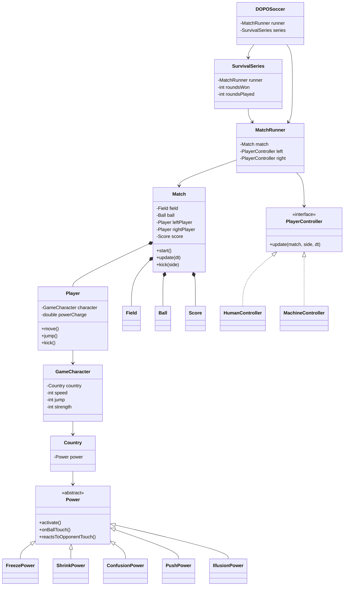

# DOPOSoccer - Informe de implementación por fases

**Proyecto:** simulación de futbol de cabezas (Head Soccer)
**Materia:** DOPO 2026-2
**Repositorio de trabajo:** `POOBsoccer/`
**Tecnologías:** Java 21, Swing, Java2D, JUnit 5
**Estado:** fases 1 a 7 completadas
**Última verificación:** 166 pruebas ejecutadas, 166 exitosas

---

## 1. Resumen ejecutivo

Se implementó un juego completo de futbol de cabezas con arquitectura en dos
capas:

- `src/domain/`: motor del juego sin dependencias de Swing. Contiene la física,
  las reglas de los partidos, los jugadores, los poderes, la inteligencia
  artificial y la serie de supervivencia.
- `src/presentation/`: aplicación de escritorio Swing/Java2D. Contiene el menú
  principal, la pantalla de configuración, el panel de juego, el HUD, la pausa y
  la pantalla de resultados.

El juego permite tres modalidades (PvsP, PvsM y MvsM), tres formas de terminar
un partido (tiempo, goles y supervivencia), cinco personajes con poderes
distintos y una serie de rondas de supervivencia en la que el jugador avanza
mientras gane.

La lógica de dominio se puede probar sin abrir ventanas. La interfaz se apoya en
una fachada del dominio llamada `DOPOSoccer` que oculta si la partida es un partido único o
una serie de supervivencia.

---

## 2. Objetivos y alcance

### 2.1 Objetivo general

Construir una simulación jugable de Head Soccer aplicando los conceptos de
programación orientada a objetos vistos en la materia: encapsulamiento,
herencia, polimorfismo, interfaces, composición, excepciones y pruebas unitarias.

### 2.2 Objetivos específicos cumplidos

- Motor de partido con física de balón, jugadores, gravedad, rebotes y colisiones.
- Acciones de jugador: moverse, saltar, patear y cargar el poder.
- Cinco poderes con efectos diferentes y activación mediante el siguiente golpe.
- Tres modalidades: jugador contra jugador, jugador contra máquina y máquina
  contra máquina.
- Inteligencia artificial básica que persigue el balón, salta, patea y usa el
  poder.
- Modo supervivencia por rondas con conteo de rondas jugadas y ganadas.
- Interfaz gráfica completa con menús, configuración, HUD, pausa y resultados.
- Pruebas unitarias y de integración para el dominio y para la sesión de juego.
- Documentación técnica y manual de ejecución.

### 2.3 Fuera del alcance

No se implementaron audio, multijugador en red, persistencia de puntajes,
controles de gamepad, sprites externos ni varios niveles de dificultad de la IA.
La interfaz dibuja todo de forma procedural con Java2D.

---

## 3. Estructura del proyecto

```
POOBsoccer/
├── src/
│   ├── domain/
│   │   ├── Ball.java
│   │   ├── CharacterCatalog.java
│   │   ├── ConfusionPower.java
│   │   ├── Country.java
│   │   ├── Field.java
│   │   ├── FreezePower.java
│   │   ├── GameCharacter.java
│   │   ├── GameMode.java
│   │   ├── Goal.java
│   │   ├── Hitbox.java
│   │   ├── HumanController.java
│   │   ├── IllusionPower.java
│   │   ├── MachineController.java
│   │   ├── Match.java
│   │   ├── MatchConfig.java
│   │   ├── MatchRunner.java
│   │   ├── MatchState.java
│   │   ├── MatchType.java
│   │   ├── Player.java
│   │   ├── PlayerController.java
│   │   ├── DOPOSoccer.java
│   │   ├── DOPOSoccerException.java
│   │   ├── Power.java
│   │   ├── PushPower.java
│   │   ├── Score.java
│   │   ├── ShrinkPower.java
│   │   ├── Side.java
│   │   ├── SurvivalSeries.java
│   │   └── Winner.java
│   └── presentation/
│       ├── CharacterCard.java
│       ├── ChoiceChip.java
│       ├── GameFrame.java
│       ├── GamePanel.java
│       ├── GameSetup.java
│       ├── HeadSoccerApp.java
│       ├── HelpDialog.java
│       ├── MainMenuPanel.java
│       ├── MenuButton.java
│       ├── SetupPanel.java
│       └── UiTheme.java
├── test/
│   ├── domain/         (pruebas del motor)
│   └── presentation/   (pruebas del teclado sin abrir ventana)
├── lib/
│   └── junit-platform-console-standalone-1.14.4.jar
├── resources/          (reservado para recursos futuros)
├── README.md
└── INFORME_FASES.md
```

La carpeta vieja `DopoSoccer/` (una copia anterior del proyecto) se eliminó. El
archivo UML `HeadSoccer.astah` también quedó intacto y es responsabilidad del
autor del proyecto.

---

## 4. Arquitectura general

### 4.1 Separación dominio / presentación

El dominio no importa clases de Swing ni de AWT. Los rectángulos de colisión son
una clase propia, `Hitbox`, lo que mantiene el motor independiente de la
interfaz gráfica y facilita las pruebas.

La presentación depende del dominio a través de la fachada `DOPOSoccer` y de las clases
públicas del motor (`Match`, `Player`, `Ball`, `MatchConfig`, etc.).

```
┌──────────────────────────────────────────────────────────────┐
│                        Presentación                         │
│  HeadSoccerApp → GameFrame → MainMenuPanel / SetupPanel      │
│                        │                                     │
│                        ▼                                     │
│                    GamePanel                                 │
│                        │                                     │
│                   DOPOSoccer  ──────────────┐               │
└────────────────────────┼──────────────────────┼──────────────┘
                         ▼                      ▼
              ┌────────────────────┐   ┌────────────────────┐
              │   MatchRunner      │   │  SurvivalSeries    │
              │  Match + controles │   │  serie de rondas   │
              └─────────┬──────────┘   └─────────┬──────────┘
                        ▼                        ▼
              ┌──────────────────────────────────────────────┐
              │        Dominio: Match, Player, Ball,         │
              │        Field, Goal, Score, Power, IA...      │
              └──────────────────────────────────────────────┘
```

### 4.2 Flujo de una partida normal

1. `SetupPanel` construye un `MatchConfig` y un `GameSetup`.
2. `GameFrame` crea un `DOPOSoccer`.
3. `DOPOSoccer` crea un `Match` y un `MatchRunner` con los controladores que
   corresponden a la modalidad.
4. `GamePanel` inicia la sesión y ejecuta un bucle de simulación con paso fijo.
5. En cada paso, `MatchRunner` actualiza primero los controladores y después la
   física del partido.
6. Al terminar, `GamePanel` muestra la pantalla de resultado y permite revancha o
   volver al menú.

### 4.3 Flujo de una serie de supervivencia

1. `DOPOSoccer` detecta `MatchType.SURVIVAL` y crea una `SurvivalSeries`.
2. La serie crea una `Match` nueva por ronda.
3. Si el jugador izquierdo gana la ronda, la serie crea la siguiente ronda.
4. Si el jugador izquierdo pierde, la serie termina y conserva el conteo.
5. `GamePanel` muestra las rondas ganadas y jugadas en el HUD y en el resultado.

---

## 5. Reglas y constantes del juego

### 5.1 Cancha

| Constante | Valor |
|---|---|
| Ancho | 1280 px |
| Alto | 720 px |
| Suelo (`groundY`) | 640 px |
| Ancho de cada arco | 100 px |
| Alto de cada arco | 280 px |
| Boca del arco | de `y = 360` a `y = 640` |
| Zona jugable horizontal | de `x = 100` a `x = 1180` |
| Radio del balón | 18 px |
| Tamaño del jugador | 70 x 120 px |
| Velocidad de simulación máxima | paso de `1/120` s |

Los arcos son huecos dentro del canvas: el arco izquierdo ocupa `x = 0..100` y
el derecho `x = 1180..1280`. El balón puede entrar en ellos, pero los jugadores
no pueden salir de la zona jugable.

### 5.2 Regla de gol

Un gol se registra cuando el balón queda **completamente contenido** dentro del
rectángulo de un arco. Un balón parcialmente dentro no cuenta.

El lado que anota es el rival del arco donde entró el balón. Por eso el autogol
queda cubierto sin lógica especial:

- Balón dentro del arco izquierdo → anota el lado derecho.
- Balón dentro del arco derecho → anota el lado izquierdo.

Después de un gol hay una pausa de 1 segundo (`GOAL_PAUSE_SECONDS = 1.0`) y luego
se reanuda el partido o se termina si ya hay ganador.

### 5.3 Formas de terminar

#### Partido por tiempo (`TIME`)

- Duración configurable; por defecto 60 segundos.
- Gana quien tenga más goles al llegar a cero.
- Si hay empate, se activa **gol de oro**: el primer gol decide el partido.
- Durante el gol de oro el cronómetro queda en cero y el HUD muestra
  `GOL DE ORO`.

#### Partido por goles (`GOALS`)

- Gana el primero en llegar al objetivo.
- El valor por defecto es 3, configurable entre 1 y 15 en la interfaz.

#### Supervivencia (`SURVIVAL`)

- Cada lado empieza con la misma cantidad de balones (5 por defecto,
  configurable entre 1 y 10).
- Cada gol le descuenta un balón al lado que lo recibe.
- Cuando un lado llega a cero, pierde la ronda.
- En la serie, el jugador izquierdo avanza mientras gane.
- La serie termina cuando el jugador izquierdo pierde.
- `MatchConfig.survival(...)` fuerza la modalidad PvsM.

### 5.4 Constantes del jugador

| Constante | Valor |
|---|---|
| Gravedad | 1800 px/s² |
| Velocidad de movimiento | `200 + 50 * speed` (250 a 450 px/s) |
| Velocidad de salto | `500 + 80 * jump` (580 a 900 px/s) |
| Velocidad de patada | `550 + 60 * strength` (610 a 850 px/s) |
| Elevación de la patada | `0.35 * velocidad` |
| Enfriamiento de patada | 0.25 s |
| Empuje al rival al patear | 40 px |
| Velocidad de empuje corporal | `220 + 30 * strength` (250 a 370 px/s) |
| Elevación al tocar con el cuerpo | 200 px/s |
| Tiempo de carga del poder | 10 s |
| Duración del aturdimiento | 3 s |
| Escala al encogerse | 0.5 |

### 5.5 Constantes del balón

| Constante | Valor |
|---|---|
| Gravedad | 1800 px/s² |
| Restitución | 0.75 |
| Fricción con el suelo | 0.98 |
| Velocidad mínima horizontal | 5 px/s |
| Velocidad mínima de rebote | 60 px/s |

El balón rebota contra el techo, el suelo, las paredes y el interior de los
arcos. En el suelo pierde velocidad horizontal por fricción y deja de rebotar
cuando la velocidad vertical es pequeña.

### 5.6 Personajes

| Personaje | Velocidad | Salto | Fuerza | Poder |
|---|---:|---:|---:|---|
| Corea del Sur | 1 | 2 | 5 | Empuje |
| Estados Unidos | 2 | 2 | 4 | Ilusión |
| Canadá | 3 | 3 | 4 | Congelación |
| Colombia | 5 | 3 | 2 | Reducción |
| Brasil | 3 | 4 | 3 | Confusión |

Las estadísticas van de 1 a 5 y se validan en el constructor de `GameCharacter`.
Un valor fuera de rango lanza `DOPOSoccerException.INVALID_STAT`.

---

## 6. Fase 1: motor del partido y física

### 6.1 Clases principales

| Clase | Responsabilidad |
|---|---|
| `Field` | Dimensiones de la cancha, suelo, arcos y posiciones iniciales. |
| `Goal` | Rectángulo de un arco y validación de contención completa del balón. |
| `Ball` | Posición, velocidad, gravedad, rebotes y efectos de poderes. |
| `Score` | Goles de cada lado, empate y líder. |
| `MatchConfig` | Configuración inmutable de modalidad, tipo, duración, goles y balones. |
| `Match` | Une cancha, balón, jugadores, marcador, tiempo y estado. |
| `MatchState` | Estados `READY`, `PLAYING`, `GOAL`, `PAUSED`, `FINISHED`. |
| `MatchType` | Tipos `TIME`, `GOALS`, `SURVIVAL`. |
| `GameMode` | Modalidades `PVP`, `PVM`, `MVM`. |
| `Side` | Lados `LEFT` y `RIGHT`, con `opposite()`. |
| `Winner` | Ganador `LEFT`, `RIGHT` o `NONE`. |

### 6.2 Bucle interno de `Match`

`Match.update(dt)` divide el tiempo recibido en pasos de como máximo `1/120`
segundos. En cada paso:

1. Actualiza al jugador izquierdo.
2. Actualiza al jugador derecho.
3. Resuelve la colisión entre jugadores.
4. Actualiza el balón.
5. Resuelve el contacto del balón con cada jugador.
6. Comprueba si hay gol.
7. Descuenta el tiempo si el partido es por tiempo.

Este subpaso hace que la física sea estable incluso si la interfaz entrega
intervalos grandes.

### 6.3 Estados del partido

```
READY ──start()──► PLAYING ──gol──► GOAL ──1 s──► PLAYING
                     │                 │
                     │                 └──si hay ganador──► FINISHED
                     ├──pause()──► PAUSED ──resume()──► estado anterior
                     └──fin de regla──► FINISHED
```

### 6.4 Posiciones iniciales

- Balón: centro de la cancha, apoyado en el suelo.
- Jugador izquierdo: `width / 4`.
- Jugador derecho: `width * 3 / 4`.
- Ambos jugadores: centro vertical a la altura del suelo menos media altura.

---

## 7. Fase 2: acciones del jugador

La clase `Player` implementa:

- `move(direction, dt, field)`: movimiento horizontal con límites de cancha.
- `jump(field)`: salto solo si está en el suelo.
- `kick(ball)`: patada si el balón está al alcance y no hay enfriamiento.
- `update(dt, field)`: gravedad, efectos, barra de poder y límites verticales.
- `touchesBall(ball)`: colisión aproximada entre el rectángulo del jugador y el
  círculo del balón.
- `intersects(other)`: colisión entre jugadores.
- `clampHorizontally(field)`: mantiene al jugador dentro de la zona jugable.

### 7.1 Contacto corporal con el balón

Cuando un jugador toca el balón sin patear, el balón sale empujado hacia el lado
contrario al jugador. La velocidad depende de la fuerza del personaje. Además se
le aplica una pequeña elevación para que el balón no quede pegado al cuerpo.

### 7.2 Patada

La patada coloca el balón delante del jugador, le da velocidad horizontal hacia
el arco rival y una elevación proporcional. Tiene un enfriamiento de 0.25
segundos para evitar patadas repetidas en el mismo instante.

Si el rival está tocando el balón en el momento de la patada, queda aturdido y
empujado 40 píxeles. Esto permite disputar el balón cuerpo a cuerpo.

### 7.3 Colisión entre jugadores

Si los rectángulos de los dos jugadores se cruzan, `Match` los separa a la mitad
del solapamiento y los vuelve a limitar a la cancha. Así se evita que uno quede
dentro del otro.

### 7.4 Barra de poder

La barra se llena linealmente en 10 segundos. Al llenarse:

- `isPowerReady()` devuelve `true`.
- `armPower()` deja el poder armado.
- El poder se conserva después de un gol, pero se desarma.
- `resetPower()` vacía la barra y desarma el poder.
- Entre partidos y entre rondas de supervivencia la barra se reinicia.

---

## 8. Fase 3: poderes

### 8.1 Diseño polimórfico

`Power` es una clase abstracta con:

- `activate(Ball, Player owner, Player opponent)`: efecto principal.
- `onBallTouch(Ball, Player owner, Player opponent)`: hook para poderes que
  dejan el balón cargado.
- `reactsToOpponentTouch()`: indica si el poder reacciona cuando el rival toca
  el balón.
- `getName()` y `getDuration()`.

Cada poder concreto hereda de `Power`. `Ball` guarda el poder activo y su dueño,
y los limpia al reiniciarse.

### 8.2 Activación

1. La barra debe estar llena.
2. El jugador presiona `Q` o `Ctrl`; el poder queda armado.
3. En el siguiente golpe al balón (patada o contacto corporal) se consume la
   carga y se ejecuta `activate(...)`.
4. Si la patada falla porque el balón no está al alcance, el poder sigue armado.
5. Al activarse, la barra queda en cero y el poder se desarma.

### 8.3 Poderes implementados

| Poder | País | Duración | Efecto |
|---|---|---:|---|
| Congelación | Canadá | 3 s | `opponent.freeze(3)`. El rival no puede moverse, saltar ni patear. |
| Reducción | Colombia | 5 s | `opponent.shrink(5)`. El ancho y alto del rival se reducen a la mitad. |
| Confusión | Brasil | 5 s | `opponent.confuse(5)`. La dirección de movimiento del rival se invierte. |
| Empuje | Corea del Sur | 3 s | El balón sale a 900 px/s y queda cargado. El rival que lo toca recibe 150 px de empuje y 3 s de aturdimiento. |
| Ilusión | Estados Unidos | 1.5 s | El balón sale a 700 px/s y crea 7 copias falsas. Mientras dura, el balón real atraviesa al rival. |

### 8.4 Detalle de Empuje

`PushPower` es el único poder que reacciona al contacto del rival con el balón
cargado. Cuando el rival toca el balón:

1. Se llama `onBallTouch(...)`.
2. El rival retrocede 150 píxeles hacia su propio arco.
3. El rival queda aturdido 3 segundos.
4. El balón se descarga.

El balón cargado se dibuja con un aura azul pulsante.

### 8.5 Detalle de Ilusión

`IllusionPower` dispara el balón y activa una ilusión de 1.5 segundos con 7
copias. Mientras la ilusión está activa:

- El balón real ignora la colisión con el rival.
- Las copias se dibujan alrededor del balón real con transparencia.
- Al terminar la ilusión, el balón vuelve a colisionar normalmente.

La interfaz marca el balón real con un aro dorado para que el jugador pueda
distinguirlo de las copias.

### 8.6 Efectos visuales de los poderes

- **Congelación:** bloque de hielo translúcido y copo de nieve.
- **Reducción:** el personaje se dibuja más pequeño por el cambio de tamaño.
- **Confusión:** espirales moradas sobre la cabeza.
- **Empuje:** aura azul alrededor del balón.
- **Ilusión:** copias semitransparentes y aro dorado en el balón real.
- **Poder armado:** aro dorado pulsante alrededor del jugador y texto
  `ARMADO - GOLPEA EL BALON` en la barra.

---

## 9. Fase 4: modalidades e inteligencia artificial

### 9.1 Contratos y controladores

| Clase | Responsabilidad |
|---|---|
| `PlayerController` | Interfaz con `update(Match, Side, dt)`. |
| `HumanController` | Mantiene una dirección mientras la tecla está presionada y consume salto, patada y poder como órdenes de un solo uso. |
| `MachineController` | IA que persigue el balón, se ubica para empujarlo, salta, patea y usa el poder. |
| `MatchRunner` | Actualiza primero los controladores y después el partido. |

### 9.2 Modalidades

| Modalidad | Lado izquierdo | Lado derecho |
|---|---|---|
| `PVP` | Humano | Humano |
| `PVM` | Humano | Máquina |
| `MVM` | Máquina | Máquina |

`MatchRunner.forMatch(match)` crea automáticamente los controladores según
`match.getConfig().getGameMode()`.

### 9.3 Comportamiento de la máquina

En cada actualización, `MachineController`:

1. Si la barra está llena y el poder no está armado, lo arma.
2. Si el balón está por encima de su cabeza y cerca horizontalmente, salta.
3. Si está tocando el balón y puede patear, patea.
4. Si no, calcula un punto detrás del balón para empujarlo hacia el arco rival:

   ```
   targetX = ball.x - attackDirection * (player.width / 2 + ball.radius - 4)
   ```

5. Se mueve hacia `targetX` si la diferencia supera 1 píxel.

El comportamiento es determinista: con las mismas posiciones y el mismo `dt`,
la máquina toma las mismas decisiones. Esto se verificó con una prueba que
ejecuta dos partidos MvsM en paralelo y compara posiciones, marcador y estado.

### 9.4 Flujo por paso

```
MatchRunner.update(dt)
    ├── si el partido está PLAYING:
    │     ├── leftController.update(match, LEFT, dt)
    │     └── rightController.update(match, RIGHT, dt)
    └── match.update(dt)
```

Si el partido está pausado, en gol o terminado, los controladores no actúan.

---

## 10. Fase 5: serie de supervivencia

### 10.1 Responsabilidad

`SurvivalSeries` encapsula una serie de partidos de supervivencia. Reutiliza la
cancha y los jugadores, pero crea un `Match` nuevo por cada ronda. Conserva los
controladores entre rondas para que la partida se sienta continua.

### 10.2 Estado

| Campo | Significado |
|---|---|
| `roundsWon` | Rondas ganadas por el jugador izquierdo. |
| `roundsPlayed` | Rondas terminadas. |
| `finished` | Si la serie ya terminó. |
| `seriesWinner` | Ganador de la serie (`RIGHT` cuando el jugador pierde). |
| `runner` | `MatchRunner` de la ronda actual. |

### 10.3 Flujo

```
start()
  └── crea la primera ronda

update(dt)
  ├── actualiza la ronda actual
  └── si la ronda terminó:
        ├── roundsPlayed++
        ├── si ganó LEFT:
        │     ├── roundsWon++
        │     └── crea la siguiente ronda
        └── si no ganó LEFT:
              ├── finished = true
              └── seriesWinner = ganador de la ronda
```

### 10.4 Reglas de la serie

- El jugador siempre es el lado izquierdo.
- La máquina es el lado derecho.
- Cada ronda empieza con la misma cantidad de balones por lado.
- La barra de poder se reinicia al comenzar cada ronda.
- El partido de cada ronda es de tipo `SURVIVAL`.
- La serie puede durar indefinidamente mientras el jugador gane.
- Al perder, se muestran las rondas ganadas y jugadas.

### 10.5 API principal

- `start()`
- `update(dt)`
- `getCurrentMatch()`
- `getRunner()`
- `getRoundsWon()`
- `getRoundsPlayed()`
- `isFinished()`
- `getSeriesWinner()`
- `getLeftController()` / `getRightController()`

---

## 11. Fase 6: interfaz Swing / Java2D

### 11.1 Clases de presentación

| Clase | Responsabilidad |
|---|---|
| `HeadSoccerApp` | Punto de entrada. Configura el look and feel y abre `GameFrame`. |
| `GameFrame` | Ventana principal con `CardLayout` para menú, configuración y juego. |
| `MainMenuPanel` | Título, botones Jugar / Cómo jugar / Salir y fondo animado. |
| `SetupPanel` | Selección de modalidad, tipo de partido, valor y personajes. |
| `GamePanel` | Bucle de juego, controles, renderizado, HUD, pausa y resultado. |
| `DOPOSoccer` | Fachada headless entre la interfaz y el dominio. |
| `GameSetup` | Datos elegidos en la configuración. |
| `UiTheme` | Colores, fuentes, gradientes y utilidades de dibujo. |
| `MenuButton` | Botón redondeado con efecto hover. |

### 11.2 Navegación

```
MainMenuPanel ──JUGAR──► SetupPanel ──COMENZAR──► GamePanel
      ▲                      │                        │
      │                      └──────VOLVER────────────┘
      │                                               │
      └────────────────── M / resultado ──────────────┘
```

- `GameFrame` mantiene la última configuración para la revancha.
- Al terminar, `R` o `Enter` reinicia con la misma configuración.
- `M` vuelve al menú principal.
- `ESC` o `P` pausa y reanuda.

### 11.3 Bucle de juego

`GamePanel` usa un `javax.swing.Timer` de 16 ms. El tiempo real se acumula y se
consume en pasos fijos de `1/120` segundos:

```java
accumulator += frameSeconds;
while (accumulator >= STEP && guard < 400) {
    session.update(STEP);
    accumulator -= STEP;
}
```

Esto desacopla la simulación de la tasa de refresco y mantiene la física estable.
El intervalo máximo por cuadro se limita a 250 ms para evitar saltos grandes
cuando la ventana se arrastra o se minimiza.

### 11.4 Entrada

Se usan `InputMap` / `ActionMap` con `WHEN_IN_FOCUSED_WINDOW`. Las teclas de
movimiento se guardan en un `Set<Integer>` para que soltar una tecla no detenga
al jugador si la otra sigue presionada.

| Acción | Jugador 1 | Jugador 2 |
|---|---|---|
| Mover izquierda | `A` | `←` |
| Mover derecha | `D` | `→` |
| Saltar | `W` | `↑` |
| Patear | `S` | `↓` |
| Poder | `Q` | `Ctrl` |
| Pausa | `ESC` / `P` | `ESC` / `P` |
| Menú | `M` | `M` |
| Revancha | `R` / `Enter` | `R` / `Enter` |

Cuando la ventana pierde el foco o se pausa, `clearInput()` suelta todas las
teclas para evitar que un jugador quede moviéndose solo.

### 11.5 HUD

- Marcador central con nombres, poderes y goles.
- Cronómetro en partidos por tiempo.
- Texto `PRIMERO A N` en partidos por goles.
- Ronda actual y rondas ganadas en supervivencia.
- Balones restantes a cada lado en supervivencia.
- Barras de poder con porcentaje, `LISTO` o `ARMADO`.
- Indicaciones de teclas para cada jugador.
- Modalidad en la parte inferior central.

### 11.6 Renderizado

Todo se dibuja con Java2D, sin imágenes externas:

- Fondo con gradiente, tribunas y puntos de público.
- Estadio con tribunas, vallas "DOPO SOCCER 2026-2" y pasto con franjas.
- Suelo de césped con franjas.
- Arcos con red, postes y líneas de meta.
- Jugadores con cabeza grande, colores del país, ojos que siguen al balón y
  cuerpo con colores del lado.
- Balón con patrón de pentágonos, rotación según posición, aura de Empuje y
  copias de Ilusión.
- Efectos de hielo, estrellas de aturdimiento, espirales de confusión y aro de
  poder armado.
- Superposiciones de pausa y resultado con paneles redondeados.

### 11.7 Pantalla de resultado

- Partido PvsP: `GANA JUGADOR 1` o `GANA JUGADOR 2`.
- Partido PvsM: `GANASTE` o `GANO LA MAQUINA`.
- Partido MvsM: `GANA MAQUINA IZQUIERDA` o `GANA MAQUINA DERECHA`.
- Supervivencia: `SERIE TERMINADA`, rondas ganadas, rondas jugadas y marcador
  de la última ronda.
- Instrucciones de revancha y menú.

---

## 12. Fase 7: pruebas, verificación y documentación

### 12.1 Estrategia de pruebas

Las pruebas se dividen en:

- **Unitarias de dominio:** validan clases aisladas (`Ball`, `Field`, `Goal`,
  `Score`, `Player`, `Power`, `GameCharacter`, `Country`,
  `CharacterCatalog`).
- **Integración de dominio:** validan partidos completos, poderes dentro del
  partido, controladores, modalidades y supervivencia.
- **Fachada y teclado:** `DOPOSoccerTest` valida la fachada y `GamePanelInputTest` el teclado, sin abrir ventanas.

### 12.2 Resultado de la suite

```
Test run finished after 362 ms
[ 21 containers found      ]
[ 21 containers successful ]
[ 166 tests found         ]
[ 166 tests successful    ]
[   0 tests failed        ]
```

### 12.3 Distribución de pruebas

| Archivo | Pruebas | Qué cubre |
|---|---:|---|
| `BallTest` | 8 | Velocidad, posición, rebotes, gravedad y reinicio. |
| `CharacterCatalogTest` | 2 | Catálogo de los cinco personajes. |
| `CountryTest` | 3 | Validación de nombre y poder del país. |
| `FieldTest` | 5 | Dimensiones, arcos, posiciones iniciales y validaciones. |
| `GameCharacterTest` | 7 | Estadísticas, nombre, país y poder. |
| `GamePanelInputTest` | 6 | Solo Ctrl derecho activa el poder, flechas con Ctrl y limpieza de entrada. |
| `GoalTest` | 6 | Contención completa del balón y geometría del arco. |
| `HitboxTest` | 3 | Bordes, centro y cruce de rectángulos de colisión. |
| `HumanControllerTest` | 7 | Dirección, salto, patada, poder y pausa. |
| `MachineControllerTest` | 15 | Persecución, defensa, bloqueo, tiempo de reacción, niveles, patada y poder. |
| `MatchConfigTest` | 7 | 60 s por defecto, metas 3/5/7, supervivencia solo PvsM y valores inválidos. |
| `MatchRunnerTest` | 5 | Creación de controladores y determinismo. |
| `MatchTest` | 23 | Inicio, goles, tiempo, gol de oro, goles objetivo, pausa y autogol y golpe directo de la patada. |
| `PlayerTest` | 20 | Movimiento, salto, patada, alcance del pie, colisiones, efectos y barra. |
| `DOPOSoccerTest` | 13 | Fachada: partido único, PvsP/PvsM/MvsM, pausa y supervivencia. |
| `PowerMatchTest` | 9 | Los cinco poderes dentro de un partido real. |
| `PowerTest` | 10 | Contratos, nombres, duraciones y hooks de poderes. |
| `ScoreTest` | 4 | Goles, empate, líder y reinicio. |
| `SurvivalSeriesTest` | 13 | Rondas, avance, derrota, reinicio, poder entre rondas y nivel de la máquina. |
| **Total** | **166** | |

### 12.4 Casos importantes verificados

- Un balón parcialmente dentro del arco no cuenta como gol.
- Un autogol acredita el gol al rival.
- El empate por tiempo activa gol de oro.
- El partido por goles termina exactamente al llegar al objetivo.
- La supervivencia descuenta el balón del lado que recibe el gol.
- La serie avanza al ganar y termina al perder.
- La barra de poder se reinicia entre rondas.
- La patada fallida no consume el poder armado.
- El poder se activa con el siguiente golpe y no antes.
- El Empuje solo reacciona cuando el rival toca el balón.
- La Ilusión deja pasar el balón real a través del rival.
- La máquina produce el mismo resultado en dos ejecuciones idénticas.
- `DOPOSoccer` pausa y reanuda sin avanzar el tiempo.
- `DOPOSoccer` oculta correctamente la diferencia entre partido y serie.

### 12.5 Comando de pruebas

```powershell
cd POOBsoccer
javac --release 21 -encoding UTF-8 -d out (Get-ChildItem src -Recurse -Filter *.java | ForEach-Object { $_.FullName })
javac --release 21 -encoding UTF-8 -cp "out;lib/junit-platform-console-standalone-1.14.4.jar" -d out (Get-ChildItem test -Recurse -Filter *.java | ForEach-Object { $_.FullName })
java -jar lib/junit-platform-console-standalone-1.14.4.jar --class-path out --scan-class-path --disable-banner --details=summary
```

---

## 13. Cómo compilar y ejecutar

### 13.1 PowerShell (Windows)

```powershell
cd POOBsoccer
javac --release 21 -encoding UTF-8 -d out (Get-ChildItem src -Recurse -Filter *.java | ForEach-Object { $_.FullName })
java -cp out presentation.HeadSoccerApp
```

### 13.2 Línea de comandos genérica

```bash
cd POOBsoccer
find src -name "*.java" > sources.txt
javac --release 21 -encoding UTF-8 -d out @sources.txt
java -cp out presentation.HeadSoccerApp
```

### 13.3 Desde el IDE

- **VS Code:** abrir `POOBsoccer/`, ejecutar `presentation.HeadSoccerApp`.
- **Eclipse:** el proyecto usa Java 21 y el JUnit de `lib/`. La clase principal
  es `presentation.HeadSoccerApp`.
- El proyecto no requiere variables de entorno ni archivos de recursos.

---

## 14. Decisiones de diseño relevantes

1. **Dominio independiente de Swing.** Permite probar toda la lógica sin abrir
   una ventana y facilita cambiar la interfaz en el futuro.
2. **`Match` con subpasos de 1/120 s.** Evita que el balón atraviese jugadores o
   arcos cuando el `dt` es grande.
3. **Arcos como huecos dentro del canvas.** Simplifica la geometría y permite
   dibujar la red sin cambiar el sistema de coordenadas.
4. **Gol por contención completa.** Evita goles cuando el balón apenas roza la
   línea.
5. **Autogol sin lógica especial.** El lado que anota se calcula como el
   contrario del arco donde entró el balón.
6. **Poder armado y activado en el siguiente golpe.** Hace que el poder sea una
   decisión estratégica y no un efecto inmediato.
7. **Hook `onBallTouch` en `Power`.** Permite que el Empuje reaccione al rival
   sin usar `instanceof` en `Match`.
8. **`MatchRunner` separado de `Match`.** Mantiene el motor de física limpio y
   permite intercambiar controladores humanos por máquinas.
9. **`SurvivalSeries` separada de `Match`.** La serie es una regla de más alto
   nivel que reutiliza el motor de partido.
10. **`DOPOSoccer` como fachada.** La interfaz no necesita saber si está
    jugando un partido único o una serie.
11. **Paso fijo en la interfaz.** La simulación no depende de los FPS reales.
12. **Todo el arte es procedural.** No hay dependencias de imágenes ni recursos
    externos; el proyecto se puede ejecutar con solo el código y el JDK.

---

## 15. Limitaciones y trabajo futuro

### 15.1 Limitaciones actuales

- No hay sonido ni música.
- No hay sprites ni animaciones cuadro a cuadro; el dibujo es procedural.
- La IA tiene una sola dificultad y no usa pathfinding.
- No hay multijugador en red ni persistencia de puntajes.
- No hay controles de gamepad.
- La ventana usa una resolución fija de 1280 x 720 y no se escala.
- La serie de supervivencia no tiene un final de victoria; termina cuando el
  jugador pierde, por diseño.
- El botón `M` vuelve al menú sin pedir confirmación.
- No hay pausa automática al minimizar la ventana; solo se sueltan las teclas.

### 15.2 Mejoras posibles

- Añadir efectos de sonido y música con `javax.sound.sampled`.
- Reemplazar el dibujo procedural por sprites o animaciones.
- Añadir dificultades de IA (fácil, normal, difícil) ajustando velocidad de
  reacción y precisión.
- Guardar récords de supervivencia en un archivo local.
- Añadir escalado de la interfaz para pantallas pequeñas.
- Añadir selección de estadio, clima o música.
- Añadir un modo torneo o copa.
- Añadir pruebas de interfaz con `java.awt.Robot` o capturas automatizadas.

---

## 16. Relación con el UML (`HeadSoccer.astah`)

El archivo `HeadSoccer.astah` pertenece al autor del proyecto y no fue modificado
por esta implementación. Las clases nuevas que conviene reflejar en el diagrama
son:

### 16.1 Dominio

- `Field` compone dos `Goal`.
- `Match` compone `Field`, `Ball`, `Score` y dos `Player`.
- `Match` usa `MatchConfig`, `MatchState`, `MatchType`, `Side` y `Winner`.
- `Player` tiene un `GameCharacter`.
- `GameCharacter` tiene un `Country`.
- `Country` tiene un `Power`.
- `Power` es abstracta y tiene cinco subclases: `FreezePower`, `ShrinkPower`,
  `ConfusionPower`, `PushPower` e `IllusionPower`.
- `PlayerController` es una interfaz implementada por `HumanController` y
  `MachineController`.
- `MatchRunner` compone un `Match` y dos `PlayerController`.
- `SurvivalSeries` compone un `MatchRunner`, una `Field`, dos `Player` y dos
  `PlayerController`.

### 16.2 Presentación

- `HeadSoccerApp` crea `GameFrame`.
- `GameFrame` compone `MainMenuPanel`, `SetupPanel` y `GamePanel`.
- `GamePanel` compone `DOPOSoccer`.
- `DOPOSoccer` compone `MatchRunner` o `SurvivalSeries`.
- `SetupPanel` produce `GameSetup`.
- `UiTheme` y `MenuButton` son utilidades de la interfaz.

### 16.3 Diagrama de relaciones simplificado



> El diagrama Mermaid es una guía de apoyo. La fuente oficial sigue siendo el
> archivo `HeadSoccer.astah` administrado por el autor.

---

## 17. Lista de verificación de requisitos

| Requisito | Estado |
|---|---|
| Motor de partido con física | Cumplido |
| Movimiento, salto y patada | Cumplido |
| Contacto corporal con el balón | Cumplido |
| Cinco personajes con estadísticas | Cumplido |
| Cinco poderes distintos | Cumplido |
| Activación del poder en el siguiente golpe | Cumplido |
| Modalidad PvsP | Cumplido |
| Modalidad PvsM | Cumplido |
| Modalidad MvsM | Cumplido |
| IA que persigue, salta, patea y usa poder | Cumplido |
| Partido por tiempo con gol de oro | Cumplido |
| Partido por goles | Cumplido |
| Supervivencia por rondas | Cumplido |
| Conteo de rondas ganadas y jugadas | Cumplido |
| Interfaz Swing/Java2D | Cumplido |
| Menú principal | Cumplido |
| Configuración de partida y personajes | Cumplido |
| HUD con marcador, tiempo y poderes | Cumplido |
| Pausa y reanudación | Cumplido |
| Pantalla de resultado y revancha | Cumplido |
| Pruebas unitarias y de integración | Cumplido |
| Documentación técnica | Cumplido |
| `HeadSoccer.astah` sin modificar | Cumplido |

---

## 18. Conclusión

El proyecto quedó implementado de principio a fin con una separación clara entre
la lógica del juego y la interfaz. El motor de dominio cubre física, reglas,
poderes, IA y supervivencia, y está respaldado por 166 pruebas automatizadas.
La interfaz Swing/Java2D ofrece menús, configuración, partidas completas, HUD,
pausa y resultados, usando únicamente dibujo procedural.

La estructura permite extender el juego con nuevos poderes, personajes,
modalidades o efectos sin reescribir el motor. Las decisiones de diseño más
importantes fueron el paso fijo de simulación, la separación entre `Match` y
`MatchRunner`, la fachada `DOPOSoccer` y el uso de polimorfismo para los
poderes.
