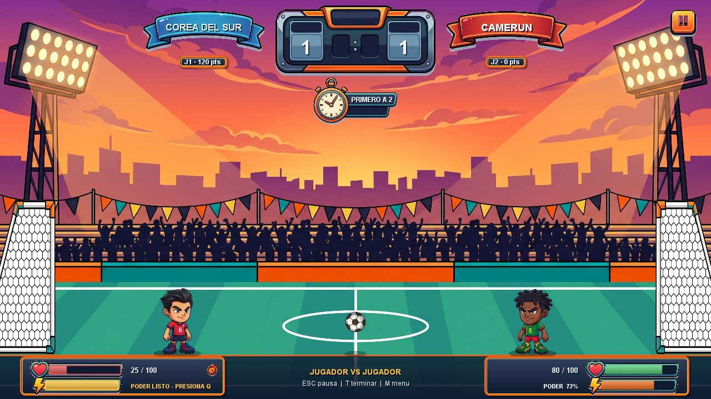
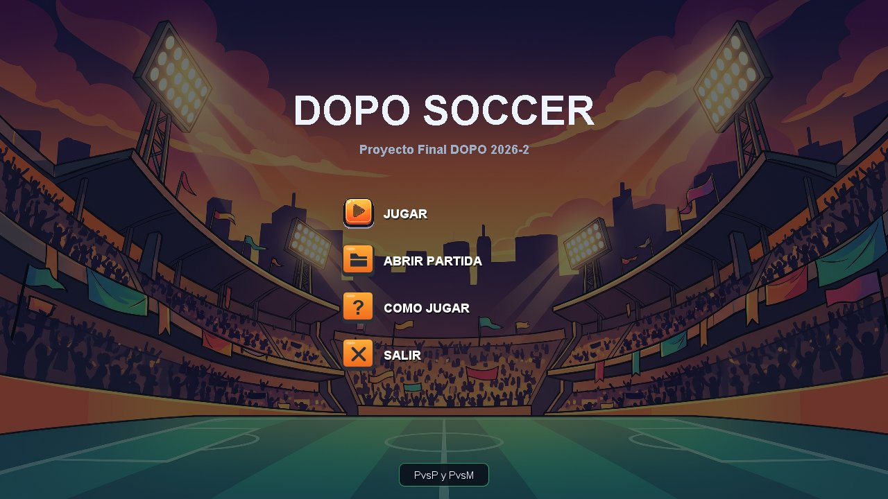
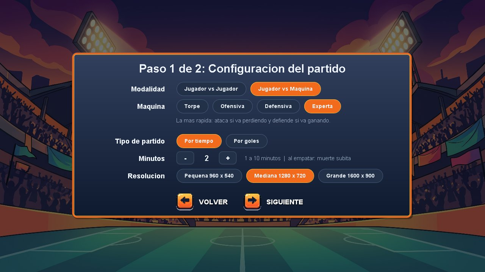
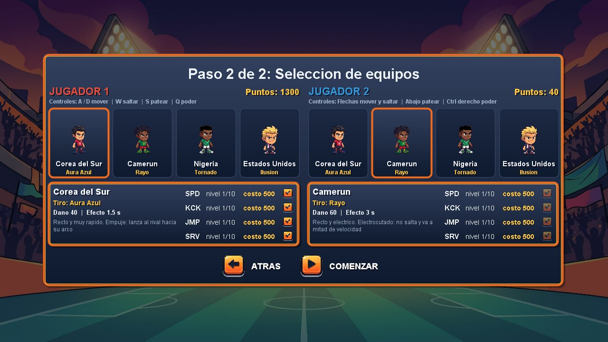

<div align="center">

# ⚽ DOPOSoccer

**Fútbol de cabezas 2D en Java 21, al estilo *Head Soccer***

Proyecto final del curso DOPO 2026-2



</div>

---

## 📌 Estado

**Versión final del proyecto.** Incluye los modos Jugador vs Jugador y Jugador vs Máquina, cuatro
personajes con poderes, mejoras con progreso persistente, partidas guardables y una interfaz
completa con Swing y Java2D.

## ✨ Características

### 🎮 Modos de juego

- **Jugador vs Jugador (PVP):** dos personas en el mismo teclado.
- **Jugador vs Máquina (PVM):** la máquina juega con uno de cuatro perfiles. Activa su poder
  cuando la barra está llena.

| Perfil | Reacción | Comportamiento |
|---|---|---|
| **Torpe** | 0.45 s | Va a puntos al azar, salta el 25 % de las veces y patea al azar, incluso hacia su propio arco. |
| **Ofensiva** | 0.15 s | Se pone detrás del balón para atacar. |
| **Defensiva** | 0.15 s | Se queda cerca de su arco; sale solo si el balón está en su mitad. |
| **Experta** (por defecto) | 0.10 s | Si va perdiendo o está en muerte súbita ataca; si va ganando defiende; con empate juega equilibrado. |

### ⏱️ Tipos de partido y resoluciones

- **Por tiempo:** de 1 a 10 minutos (por defecto 2).
- **Por goles:** de 1 a 10 goles (por defecto 3).
- **Resoluciones:** 960x540, **1280x720** (por defecto) y 1600x900.

### 🌍 Personajes y poderes

| Personaje | Poder | Daño | Efecto sobre el rival | Duración |
|---|---|---|---|---|
| Corea del Sur | Aura Azul | 40 | Empuje | 1.5 s |
| Camerún | Rayo | 60 | Electrocutado (velocidad ×0.5) | 3 s |
| Nigeria | Tornado | 40 | Inconsciente | 3 s |
| Estados Unidos | Ilusión | 30 | Confusión (7 señuelos) | 2.5 s |

El daño final es el daño del poder multiplicado por el multiplicador de KCK del jugador.

### 📈 Mejoras y puntos

| Mejora | Qué sube | Valor base |
|---|---|---|
| **SPD** | Velocidad | 300 |
| **KCK** | Daño de las patadas y de los poderes | 10 |
| **JMP** | Altura de salto | 150 |
| **SRV** | Vida máxima | 100 |

- Cada mejora va del nivel 1 al 10 con multiplicador `1 + 0.10 × (nivel − 1)` (máximo 1.90x).
- Costo de subir de nivel: `500 × 2^(nivel − 1)` (500, 1000, 2000 … 128000 puntos).
- Puntos por partido: **100** al ganador, **25** al perdedor y **0** en empate.

### 💾 Persistencia

- **Progreso:** los puntos y mejoras se guardan en `dopo_progress.dat` (serialización de Java, en el
  directorio de trabajo). Se escribe al volver al menú, al empezar un partido y al salir.
- **Guardar partida:** con la tecla `G` se abre un `JFileChooser` y se guarda un archivo `.dopo` con
  el marcador, el tiempo, las posiciones, la vida, las barras de poder, los efectos y los perfiles.
  No se puede guardar si el partido no ha empezado o ya terminó.
- **Abrir partida:** desde el menú, `ABRIR PARTIDA`; el partido queda en pausa.
- **Errores:** se registran en `dopo_errors.log`.

## 🧰 Requisitos

- JDK 21 o superior.
- **Con Maven:** Maven 3.9 o superior (descarga JUnit solo).
- **Sin Maven:** JUnit 5 ya viene en `lib/junit-platform-console-standalone-1.14.4.jar`.

## 🚀 Cómo ejecutar

**VS Code:** abre la carpeta del proyecto, instala la extensión de Java y presiona `F5` con la
configuración **DOPOSoccer** de `.vscode/launch.json`.

**Maven**, desde la raíz del repositorio:

```powershell
mvn compile exec:java      # abre el juego
mvn package                # genera target/doposoccer-1.0.jar
java -jar target/doposoccer-1.0.jar
```

**PowerShell sin Maven**, desde la raíz del repositorio:

```powershell
javac -encoding UTF-8 -d out (Get-ChildItem src -Recurse -Filter *.java | ForEach-Object { $_.FullName })
java -cp "out;resources" presentation.DOPOSoccerApp
```

`resources` va en el classpath porque ahí están las imágenes del juego.

## 🕹️ Cómo jugar

1. **Menú principal:** `JUGAR`, `ABRIR PARTIDA`, `CÓMO JUGAR` o `SALIR`.
2. **Paso 1, Configuración:** modalidad, perfil de la máquina (solo en PVM), tipo de partido con su
   valor (botones −/+) y resolución.
3. **Paso 2, Selección de equipos:** personaje de cada jugador (por defecto Corea del Sur y Camerún)
   y mejoras.
4. Presiona **COMENZAR**.

| Menú | Paso 1: Configuración | Paso 2: Equipos |
|:---:|:---:|:---:|
|  |  |  |

### Controles

| Acción | Jugador 1 (izquierda) | Jugador 2 (derecha) |
|---|---|---|
| Mover | `A` / `D` | `←` / `→` |
| Saltar | `W` | `↑` |
| Patear | `S` | `↓` |
| Poder | `Q` | `Ctrl` derecho |

| Tecla | Acción |
|---|---|
| `ESC` o `P` | Pausar / reanudar |
| `G` | Guardar la partida |
| `T` | Terminar el partido ya (gana quien va arriba; empate = sin ganador) |
| `M` | Volver al menú (descarta el partido) |
| `R` o `Enter` | Revancha (al terminar el partido) |

## 🏗️ Arquitectura

El proyecto separa el motor del juego de la interfaz:

- **`domain`** es el motor: reglas, física, jugadores, poderes y archivos. **Nunca importa
  `presentation`**, por lo que se puede probar con JUnit sin abrir ninguna ventana y reutilizar con
  otra interfaz.
- **`presentation`** (Swing y Java2D) solo dibuja y captura el teclado; toda la lógica la delega al
  dominio.

| Capa | Clase | Responsabilidad |
|---|---|---|
| domain | `DOPOSoccer` | Fachada del dominio: crea, avanza, guarda y abre partidos. |
| domain | `Match`, `MatchRunner`, `MatchConfig` | Partido, su ciclo de actualización y su configuración. |
| domain | `Player`, `Ball`, `Field` | Jugador, balón y cancha. |
| domain | `PlayerController` → `HumanController`, `MachineController` (+ 4 subclases) | Quién maneja a cada jugador. |
| domain | `MachineProfile`, `ProfileRegistry` | Perfiles de la máquina y registro del progreso. |
| domain | `PlayerProfile`, `Stats`, `StatType` | Puntos y mejoras de cada jugador. |
| domain | `PowerShot` + 4 tiros, `Effect` | Poderes y efectos sobre el rival. |
| domain | `CharacterCatalog` | Catálogo de personajes. |
| domain | `ObjectFiles`, `ErrorLog` | Archivos serializados y registro de errores. |
| presentation | `GameFrame` | Ventana; usa `CardLayout` para menú, configuración y juego. |
| presentation | `MainMenuPanel`, `SetupPanel` (2 pasos), `GamePanel` | Pantallas del juego. |
| presentation | `SpriteLoader`, `UiTheme` | Imágenes con caché y estilo visual. |

Los errores del dominio se manejan con `DOPOSoccerException`.

## 🧪 Pruebas

**Con Maven:**

```powershell
mvn test
```

Los reportes quedan en `target/surefire-reports/`.

**Sin Maven:**

```powershell
javac -encoding UTF-8 -d out -cp "lib\junit-platform-console-standalone-1.14.4.jar" (Get-ChildItem src,test -Recurse -Filter *.java | ForEach-Object { $_.FullName })
java -jar lib\junit-platform-console-standalone-1.14.4.jar execute -cp "out;resources" --scan-classpath
```

Resultado actual: **248 pruebas, 248 exitosas**.

## 📁 Estructura

```
src/domain/          Motor del juego
src/presentation/    Interfaz Swing/Java2D
test/domain/         Pruebas del dominio (JUnit 5)
test/presentation/   Pruebas de la interfaz que no abren ventana
resources/           fonts, sprites y ui (imágenes del juego)
lib/                 JUnit 5 (para compilar sin Maven)
docs/capturas/       Capturas de pantalla
HeadSoccer.asta      Diagramas de Astah
pom.xml              Construcción y pruebas con Maven
README.md
```

## 👥 Créditos

- **Autores:** Alejandro Ospina, Carlos Felipe Jiménez.
- Proyecto final del curso DOPO 2026-2.
- **Recursos gráficos:** los sprites, fondos e interfaz son imágenes propias o libres, sin material
  del Head Soccer original; los detalles están en `resources/ASSETS.md`.
